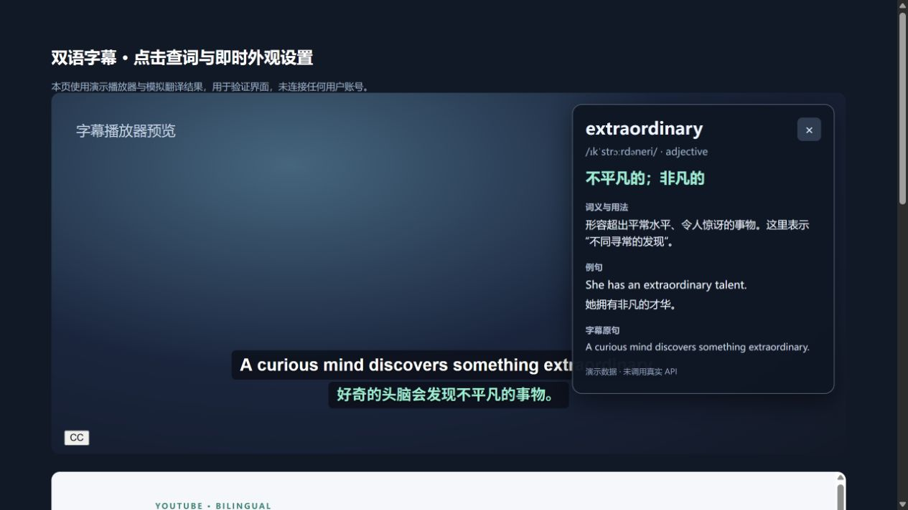
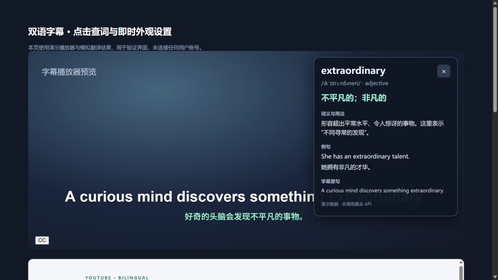

# youtube双语插件 v1.2.0

桌面 Chrome / Edge 的 Manifest V3 扩展。上行原字幕，下行译文；支持微软、谷歌、DeepSeek、小米 MiMo、自定义兼容 AI。无需构建、无需 npm install。

## 功能预览

以下截图来自本地演示播放器，使用模拟接口数据。





## 本版更新

- 原字幕单词可以点击查词。只在点击时发起请求，鼠标悬停不查询。卡片显示词义、用法、可用的音标/词性及例句，并保留点击时的字幕原句。Esc、关闭按钮或点击卡片外可关闭。不会自动暂停视频。
- 原文和译文字号独立设置，播放器内直接应用像素字号，避免样式继承导致看不出变化。
- 字幕背景不透明度支持 0–100%（0% 完全透明，100% 完全不透明）。字号、背景、位置滑块即时应用并自动保存，无需点击保存。
- 外观设置不再清空字幕译文缓存或取消正在进行的翻译。
- 默认提前翻译未来 90 秒，可选 30/60/90/180 秒；倍速播放时最多扩展到 180 秒，并限制候选句数和字符量。
- 拖动时终止旧播放位置的待处理和进行中请求，松开后先处理新位置当前句与紧邻的 2 句，再并行准备后面的批次。已经完成的译文缓存保留，拖回原位置可复用。
- 后台最多 4 个翻译任务；预翻译最多占 2 个名额，为当前字幕与查词保留容量。当前句不再加入尚未完成的慢预取批次。
- 记录脚本初始化前已经返回的播放器原生字幕响应；拉取字幕时保留原始签名参数和格式，减少预取轨道无法获取的情况。
- 弹窗增加预翻译状态：页面插件版本、轨道/逐句模式、字幕句数、缓存数量、接下来 30 秒就绪程度及错误提示。

## 安装与更新

1. 解压 ZIP，保留整个 `youtube-bilingual` 文件夹。
2. Chrome 打开 `chrome://extensions`；Edge 打开 `edge://extensions`。
3. 开启“开发者模式”，点击“加载已解压的扩展程序”，选择包含 `manifest.json` 的文件夹。
4. 已安装旧版时，用新版内容覆盖原来加载的文件夹，在扩展管理页点“重新加载”，然后刷新 YouTube。原路径更新可以保留扩展 ID 与本地 Key。
5. 新增英文词典接口访问权限；如果浏览器提示权限变化，确认后重新启用扩展。
6. 打开插件“API 与字幕设置”，选择服务、填写 Key 和模型，保存并测试，再开启双语字幕。
7. 在 YouTube 开启 CC，在播放器设置里选择原语字幕；上行将使用这一轨道。

刷新扩展后也必须刷新已经打开的 YouTube 页面，否则页面仍然运行旧内容脚本。弹窗“查看字幕预翻译状态”可以确认页面是否运行 v1.2.0。

## 服务配置

| 服务 | 配置 |
| --- | --- |
| 微软翻译 | Azure Translator Key；区域型/多服务资源还需 Region |
| 谷歌翻译 | 已启用 Cloud Translation Basic v2 的 Google Cloud API Key |
| DeepSeek | Key 和模型 ID；默认 deepseek-flash，可改 |
| 小米 MiMo | Key 和控制台可用的文本模型 ID |
| 自定义 AI | 完整 HTTPS Chat Completions 地址、Bearer Key 和模型 ID |

AI 地址要包含 `/chat/completions`。微软与谷歌采用正式 API，网页账号不能直接替代 Key。密钥按服务分别保存。字幕目标语言支持 17 种。

DeepSeek / MiMo 显式关闭深度思考。自定义服务不强制传入思考参数，避免破坏协议兼容性。AI 批次需按顺序返回相同数量的译文；格式不兼容时改用单句预翻译。

## 点击查词

- **点击上行原字幕中的单词**，卡片会显示在播放器右上角。下行译文不提供点击查询，悬停也不会触发请求。
- 使用 DeepSeek、MiMo、自定义 AI 时，由当前模型结合点击时的原句解释。
- 使用微软/谷歌时，由 Free Dictionary API 提供英文词典释义，再由当前翻译服务翻译。没有收录的词显示单词翻译与说明；不会编造词典条目。
- 非英文词汇的完整解释请使用 AI 服务。词典有词性/音标/例句时才展示这些字段。
- 快速换词或关闭卡片后，旧请求返回也不会覆盖新词或重新打开卡片。
- AI 查询会发送所点词汇和附近原句给当前模型；传统词典查询只向词典服务发送所点英文词汇，Key 不会发送给词典。

## 字幕外观

弹窗与设置页都提供原文字号、译文字号、背景不透明度、距底部位置滑块，边拖边生效且自动保存。翻译服务和预翻译范围仍需点击“保存设置”。

原文字号范围 14–48 px；译文字号 12–48 px；背景不透明度 0–100%；底部距离 5–45%。词典卡片使用独立的固定背景，保证解释可读。

## 预翻译与进度拖动

优先解析当前字幕轨道的 JSON3/XML 时间轴。当前句使用高优先级单句请求，最近两句小批预取，后面的字幕采用最多 6 句的批次；字幕显示始终按视频当前时间选择对应句子。

拖动中不为不断变化的位置发请求；目标位置稳定约 250 毫秒后，即使视频还在缓冲，也提前准备这一位置的字幕。再次移动时取消该位置的未完成请求，结束拖动后继续填充预取窗口。已发送给服务商的请求即使中断，也可能已产生用量。

本地每页缓存最多 2400 条译文；后台共享最多缓存 1200 条字幕译文，另缓存词典查询。缓存仅在当前浏览器扩展会话内保留。切换翻译服务、目标语言或 Key 后清除旧配置缓存；外观变化保留缓存。

获取不到完整字幕轨道时自动回退到 DOM 逐句翻译。此模式无法知道未出现的未来字幕，弹窗会明确显示“实时逐句翻译”。可关开一次 CC 促使播放器重新读取轨道。没有字幕的视频无法翻译，不包含语音识别。

跳到从未准备过的位置时，当前句仍需要首次联网请求；网络和模型速度仍然影响等待时间，不能承诺所有位置都瞬时出译文。可以在弹窗查看“接下来 30 秒就绪”数量，以判断预翻译是否真正运行。

## 排查

- 字号看起来不变：确认扩展与视频页面都已经重新加载，弹窗显示页面版本 v1.2.0；在视频播放时拖动滑块查看效果。
- 无字幕：确认插件开启、YouTube CC 开启、视频原字幕可用。上行使用 YouTube 选择的轨道，想保留原文就不要先在 YouTube 启用自动翻译。
- 401/403：核对 Key、API 开通、余额、Azure 区域、Key 限制及接口域名授权。
- 404：核对接口路径或模型 ID。
- 429：等待限流恢复或调整服务额度。
- 网络失败：确认可以连接服务域名；自定义域名在设置保存时授权。

桌面 youtube.com 普通播放器为主要支持范围，Shorts、嵌入站点、移动站、投屏和画中画暂不保证。YouTube 的字幕接口与播放器 DOM 会变化，可能需要更新解析逻辑。

## 数据与安全

默认关闭翻译。启用后字幕发送到选择的翻译服务，可能产生字符/token 费用；预取可能包含之后没有实际观看的字幕。查词仅在点击时请求。

Key 明文保存在扩展 `chrome.storage.local`，不云同步、不写入日志、不发送给 YouTube。内容脚本无权直接读取密钥。网络请求禁止重定向；Google Key 使用请求头。所有译文、释义与字幕作为纯文本呈现。

无广告、统计或第三方自建中转。英文词典来源：[Free Dictionary API](https://dictionaryapi.dev/)。

## 开发与验证

```sh
npm test
```

无需安装依赖。39 项测试覆盖请求格式、取消信号、排队优先级、拖动竞态、字幕获取、时间轴、预取命中、查词点击/非悬停、延迟响应、字体与透明度设置以及外观变更保留缓存。

已在本地浏览器预览中实际操作字号、透明度滑块和点击查词，使用的是模拟播放器/模拟接口数据。真实付费服务的延迟与所有 YouTube 视频的端到端兼容性仍需结合用户账号验证。

主要文件：`content.js`（播放与字幕）、`subtitle-bridge.js`（轨道获取）、`subtitle-core.js`（时间轴）、`background.js`/`scheduler.js`（服务与调度）、`dictionary.js`/`dictionary-ui.js`（查词）、`appearance-ui.js`（即时外观）。

## 官方接口参考

- [微软 Translator](https://learn.microsoft.com/en-us/rest/api/translator/translator/translate)
- [Google Cloud Translation v2](https://docs.cloud.google.com/translate/docs/reference/rest/v2/translate)
- [DeepSeek](https://api-docs.deepseek.com/)
- [小米 MiMo](https://mimo.mi.com/docs/en-US/api/chat)

这是个人本机加载版。商店发布另需图标、截图、隐私政策及完整兼容性验收。
